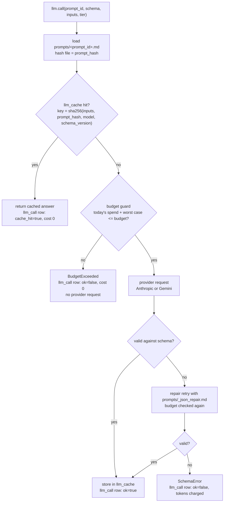

# Module `rlg.llm` — provider-agnostic LLM client

## Purpose
The only door to an LLM. Every LLM call in the project is
`llm.call(prompt_id, schema, inputs, tier)`. The module picks the model for the tier,
fills in the prompt file, asks the provider for JSON that matches a schema, checks the
answer, and repairs it once if needed. It also caches answers, so the same question is
never paid for twice, logs the cost of every call, and refuses calls that would go over
the daily budget.

## Classes and functions
| Name | File | Role |
|---|---|---|
| `call(prompt_id, schema, inputs, tier)` | `client.py` | Module-level entry point; uses `default_client()`. |
| `default_client()` | `client.py` | Process-wide `LLMClient` wired to the Postgres ledger. |
| `LLMClient` | `client.py` | Resolves tier → provider/model, renders prompts, runs cache → budget → request → validate → repair. |
| `LLMClient.call_with_meta` | `client.py` | Same as `call` but returns a `CallResult` (output, cost, cache hit, attempts). |
| `CallResult` | `client.py` | Validated output plus prompt, tier, cache key, cost and attempts. |
| `SchemaError` | `client.py` | Raised when the answer is still invalid after the one repair retry. |
| `SqlLedger` | `ledger.py` | Reads/writes `llm_cache`; sums today's spend; appends `llm_call` rows. |
| `BudgetExceeded` | `ledger.py` | Raised before any provider request when a call could exceed the daily (or triage) budget. |
| `Prompt` | `prompts.py` | A loaded prompt file: text, id, sha256 (`prompt_hash`); `render()` fills `{{name}}` slots. |
| `load_prompt(prompt_id)` | `prompts.py` | Reads `prompts/<prompt_id>.md` and hashes it. |
| `PromptError` | `prompts.py` | Unknown prompt, unsafe id, or a missing input for a placeholder. |
| `Provider` | `providers.py` | Interface: turn a `ProviderRequest` into JSON text plus token counts. |
| `ProviderRequest` / `ProviderResponse` | `providers.py` | What is sent (model, system, user, schema, max tokens) / received (text, tokens, model). |
| `ProviderError` | `providers.py` | The provider refused (e.g. a safety refusal); retrying the same input won't help. |
| `AnthropicProvider` | `providers.py` | Claude via the Anthropic SDK with JSON-schema structured output. The only place that imports `anthropic`. |
| `GeminiProvider` | `providers.py` | Gemini via `google-genai` with a JSON response schema. The only place that imports `google.genai`. |
| `ReplayProvider` | `replay.py` | For tests: replays recorded answers from `tests/fixtures/llm_recordings/`, or records them in live mode. |

## Prompts used
| File | Used for |
|---|---|
| `prompts/_json_output.md` | System prompt on every call: "answer only with JSON matching this schema" + the schema. |
| `prompts/_json_repair.md` | Appended on the single repair retry: shows the validation error and the previous answer. |
| `prompts/<prompt_id>.md` | The task prompt each stage passes by id (added by later phases). |

## Configuration read
`config/models.yaml` tiers: `triage` (Claude Haiku 5.5), `extract` (Claude Sonnet 5.5),
`adjudicate` (Claude Opus 5.5) with prices per million tokens and training cutoffs;
`budgets.daily_llm_usd` (overridden by `DAILY_LLM_BUDGET_USD` in `.env`) and
`budgets.triage_daily_usd`.

## Data read and written
| Table | Read | Written |
|---|---|---|
| `llm_call` | today's `cost_usd` sum (budget guard) | exactly one row per `llm.call`: provider, model, model_cutoff, tier, prompt_id, prompt_hash, schema_version, cache_key, tokens, cost_usd, cache_hit, attempts, started_at, ok, error |
| `llm_cache` | cached answer by `cache_key` | one row per new validated answer (first writer wins) |

## Deterministic vs LLM decisions
- **Deterministic:** which model a tier uses, the cache key, the budget decision, whether
  the output is schema-valid, whether to retry (exactly once), what gets logged.
- **LLM:** only the content of the JSON answer. This module never writes LLM output to
  any canonical table; callers put it in `candidate_*` tables (later phases).

## Failure modes
| Failure | What happens |
|---|---|
| Daily or triage budget would be exceeded | `BudgetExceeded` before any request; logged with cost 0. |
| Invalid JSON / schema mismatch twice | `SchemaError`; the tokens of both attempts are logged and count toward spend. |
| Provider refusal | `ProviderError`; logged as failed. |
| Network / API errors | The SDKs retry transient errors themselves; whatever still fails is logged and re-raised. |
| Two workers making calls at the same time | The budget check is per process, so they can overshoot by at most one worst-case call each. |
| Prompt file edited | Its hash changes, so the cache key changes and the next call is a fresh paid call (by design). |
