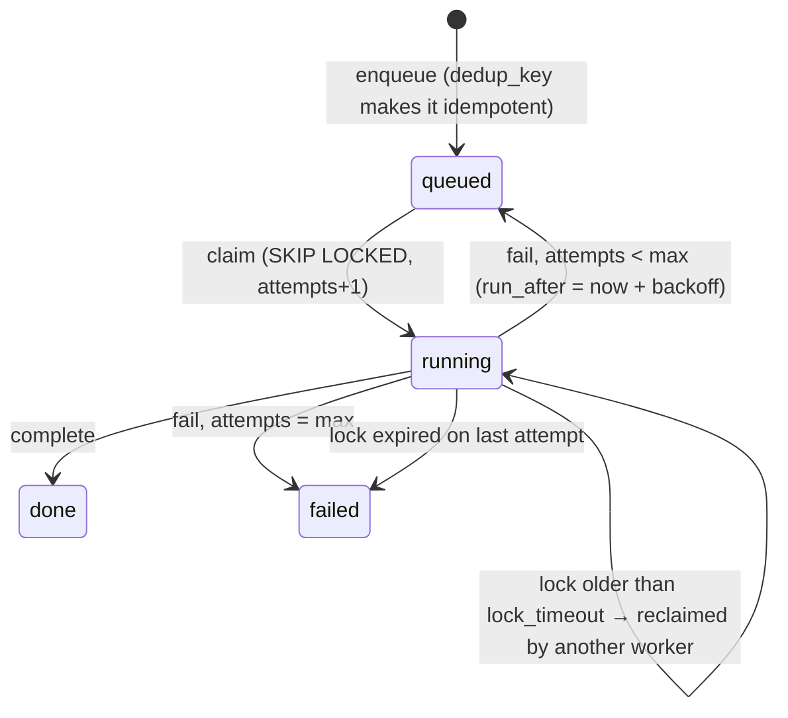

# Module `rlg.queue` — Postgres job queue

## Purpose
A simple, crash-safe work queue inside Postgres, so pipeline stages can run as resumable
background jobs without adding another service. Workers grab jobs with
`FOR UPDATE SKIP LOCKED`, so two workers never get the same job. Failed jobs are retried
with growing delays, and jobs held by a worker that died are picked up again after a
timeout.

## Classes and functions
| Name | File | Role |
|---|---|---|
| `Job` | `jobs.py` | A claimed job: id, kind, payload, attempts, max_attempts, locked_by. |
| `enqueue(engine, kind, payload, dedup_key=...)` | `jobs.py` | Adds a job; the same `dedup_key` twice is a no-op. |
| `claim(engine, worker_id, kinds=..., lock_timeout=...)` | `jobs.py` | Atomically takes the next runnable job (or a job whose lock expired). |
| `complete(engine, job)` | `jobs.py` | Marks done, only if this worker still holds the lock. |
| `fail(engine, job, error)` | `jobs.py` | Requeues with exponential backoff (30 s, 60 s, 120 s, … capped at 6 h) or marks failed at max attempts. |
| `backoff(attempts)` | `jobs.py` | The delay after the n-th failure. |
| `stats(engine)` | `jobs.py` | Job counts by kind and status. |
| `handler(kind)` / `HANDLERS` | `worker.py` | Registers the function that runs a job kind. Handlers must be idempotent. |
| `run_worker(engine, ...)` | `worker.py` | Loop: claim → run handler → complete or fail. |
| CLI `rlg queue work` / `rlg queue stats` | `cli.py` | Run a worker; show counts. |

## Prompts used
None.

## Data read and written
| Table | Read | Written |
|---|---|---|
| `job` | runnable/stale jobs (claim), counts (stats) | inserts (enqueue); status, attempts, run_after, locked_at, locked_by, last_error, finished_at (claim/complete/fail) |

## Deterministic vs LLM decisions
Everything here is deterministic. Job order is by `run_after`, then id.

## Failure modes
| Failure | What happens |
|---|---|
| Worker process killed mid-job | The job stays `running`; after `lock_timeout` (default 30 min) another worker reclaims it and the dead worker's late writes are ignored. Handlers must therefore be idempotent. |
| Handler raises | `fail` stores the error and retries later; after `max_attempts` (default 5) the job is `failed` and stays visible in `rlg queue stats`. |
| Job takes longer than `lock_timeout` | It could be run twice; set a longer timeout for slow job kinds. |
| Database down | Workers raise; nothing is lost because job state lives in Postgres. |
